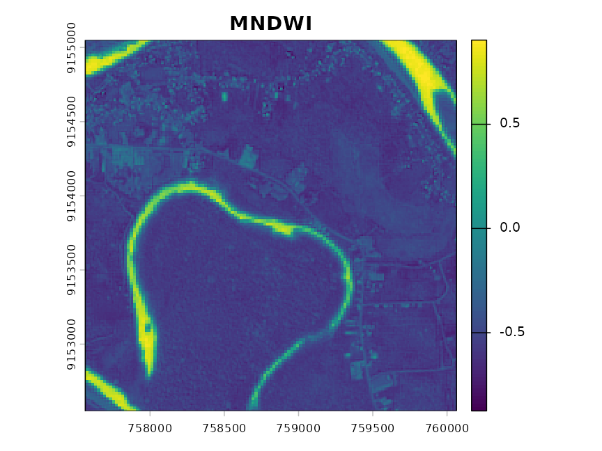
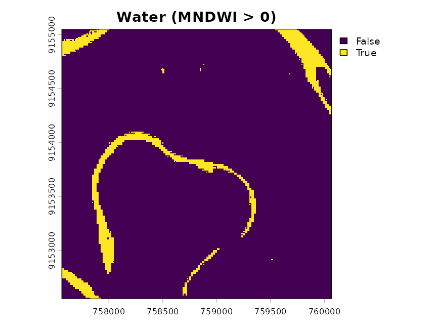
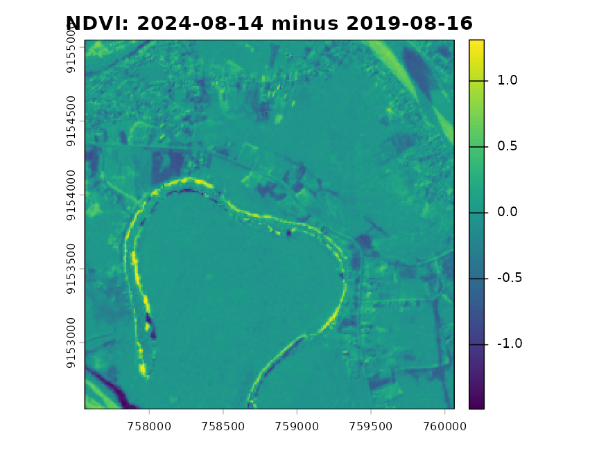

# Case study: the Jurua River (Acre, Brazil)

Got a satellite image file and don’t know where to start? **rsguide**
looks at your data, works out what it is and suggests which analyses are
possible, explaining in plain language why each one makes sense, what to
watch out for and how to do it in R.

rsguide **does not run** the analyses: it diagnoses and recommends. The
decision (and the interpretation) is still yours.

This case study uses real data from the Jurua River, near the town of
Cruzeiro do Sul, in the state of Acre, Brazil.

``` r

library(rsguide)
```

## The data

The package ships four example files in `inst/extdata`:

``` r

folder <- system.file("extdata", package = "rsguide")
list.files(folder)
#> [1] "jurua_dem_copernicus.tif" "jurua_plots.csv"          "jurua_s2_20190816.tif"   
#> [4] "jurua_s2_20240814.tif"
```

- `jurua_s2_20190816.tif` and `jurua_s2_20240814.tif`: 2.5 x 2.5 km
  crops of **Sentinel-2** images (level L2A, Collection 1) from the 2019
  and 2024 dry seasons, with seven bands at 10 m. The values are exactly
  as delivered by the provider (integers).
- `jurua_dem_copernicus.tif`: the Copernicus GLO-30 **digital elevation
  model** for the same area.
- `jurua_plots.csv`: 25 **fictitious** field plots with longitude and
  latitude, for demonstration only.

The data come from the public Earth Search platform (AWS); the script
that produced them is `data-raw/jurua.R` in the package repository. See
[`?jurua_data`](https://rikd96.github.io/rsguide/reference/jurua_data.md)
for details and credits.

## 1. Diagnosing one image

Start by giving the file to
[`diagnose()`](https://rikd96.github.io/rsguide/reference/diagnose.md):

``` r

img <- file.path(folder, "jurua_s2_20240814.tif")
d <- diagnose(img)
d
#> ══ rsguide diagnosis ═════════════════════════════════════════════════════════════════════
#> Inputs: 1 raster
#> 
#> ── R1 · jurua_s2_20240814 (raster) ───────────────────────────────────────────────────────
#> • Layers: 7 | Dimensions: 250 rows × 250 columns | Resolution: 10 m
#> • CRS: WGS 84 / UTM zone 18S (EPSG:32718)
#> • Extent: x from 757,564 to 760,064; y from 9,152,550 to 9,155,050
#> • Likely sensor: Sentinel-2 (MSI) (high confidence)
#> • Bands: B02 = blue; B03 = green; B04 = red; B05 = red edge; B08 = near infrared; B11 = shortwave infrared 1; B12 = shortwave infrared 2
#> • Value scale: scaled integers with offset (reflectance = (value - 1000) / 10,000)
#> • Values: minimum 920, maximum 14,192
#> • NA (no data): 0.0% in the layer with most NA
#> • Date(s): 2024-08-14 (file name)
#> 
#> ── Alerts ────────────────────────────────────────────────────────────────────────────────
#> i [R1] Almost all values are above 1000: the image seems to carry the +1000 offset of Sentinel-2 L2A (processing since 2022-01-25, including the reprocessed Collection 1). Convert to reflectance with (r - 1000) / 10000 before computing indices.
#> 
#> ══ Suggested analyses (10) ═══════════════════════════════════════════════════════════════
#> Vegetation indices
#>   • NDVI (Normalized Difference Vegetation Index) [ndvi] → 'jurua_s2_20240814'
#>   • EVI (Enhanced Vegetation Index) [evi] → 'jurua_s2_20240814'
#>   • SAVI (Soil-Adjusted Vegetation Index) [savi] → 'jurua_s2_20240814'
#>   • NDRE (Normalized Difference Red Edge index) [ndre] → 'jurua_s2_20240814'
#>   • NDMI (Normalized Difference Moisture Index) [ndmi] → 'jurua_s2_20240814'
#> Water
#>   • NDWI (Normalized Difference Water Index, McFeeters) [ndwi] → 'jurua_s2_20240814'
#>   • MNDWI (Modified NDWI) [mndwi] → 'jurua_s2_20240814'
#> Fire
#>   • NBR (Normalized Burn Ratio) and dNBR [nbr] → 'jurua_s2_20240814'
#> Classification
#>   • Supervised land use and land cover classification [supervised_class] → 'jurua_s2_20240814'
#>   • Unsupervised classification (clustering) [unsupervised_class] → 'jurua_s2_20240814'
#> 
#> i Rationale and caveats: summary(). Example code: show_code(..., "ndvi"). Table to export: as.data.frame().
```

Note what rsguide worked out on its own:

- **Sensor:** from the band names (`B02`, `B03`, …, `B12`), the image is
  from Sentinel-2. Each band was matched to its spectral region (blue,
  green, red, infrared…).
- **Scale:** the values are integers and almost all of them are
  above 1000. This reveals the *+1000 offset* that Sentinel-2 introduced
  in 2022: the actual reflectance is `(value - 1000) / 10000`.
  Forgetting this detail is a common mistake that distorts indices such
  as EVI.
- **Suggestions:** with blue, green, red, red edge, near and shortwave
  infrared, the image supports vegetation, water and burn indices, as
  well as land cover classification.

To read the rationale and caveats of each analysis, use
[`summary()`](https://rdrr.io/r/base/summary.html). To keep this
document short, only the beginning is shown here:

``` r

overview <- capture.output(summary(d))
cat(head(overview, 30), sep = "\n")
#> ══ rsguide diagnosis summary ═════════════════════════════════════════════════════════════
#> R1   jurua_s2_20240814 (raster) 
#>      7 layers · 10 m · EPSG:32718 · Sentinel-2 (MSI) · scaled integers with offset
#>        (reflectance = (value - 1000) / 10,000) · 2024-08-14
#> Alerts: 0 warning(s) and 1 note(s); see print() or as.data.frame(..., type = "alerts").
#> 
#> ══ Suggested analyses (10) ═══════════════════════════════════════════════════════════════
#> 
#> Vegetation indices
#> 1. NDVI (Normalized Difference Vegetation Index) [ndvi]
#>    Applies to: 'jurua_s2_20240814'
#>    Why: Healthy vegetation strongly reflects near infrared and absorbs red light. NDVI
#>      uses this contrast to indicate how much green vegetation each pixel contains
#>      (values from -1 to 1).
#>    Caveats:
#>      - Use surface reflectance (atmospherically corrected imagery, level L2A/L2)
#>      - Mask clouds and shadows first
#>      - In dense forests, such as the Amazon, NDVI saturates: it stays close to 1 and
#>        stops discriminating; consider EVI
#>    Packages: terra
#> 2. EVI (Enhanced Vegetation Index) [evi]
#>    Applies to: 'jurua_s2_20240814'
#>    Why: Similar to NDVI, but also uses the blue band to reduce atmospheric and soil
#>      effects. It saturates less in dense vegetation, which makes it popular in tropical
#>      forests.
#>    Caveats:
#>      - The formula only works with reflectance on a 0-1 scale: convert the values first
#>      - Mask clouds and shadows
#>      - Values far outside -1 to 1 point to scale problems or clouds
#>    Packages: terra
```

## 2. From diagnosis to code

Each suggestion comes with example code **already filled in** with the
path to your file, the names of your bands and the right scale
conversion. Here is the code for MNDWI, an index that highlights water:

``` r

code <- show_code(d, "mndwi")
#> ── MNDWI (Modified NDWI) - 'jurua_s2_20240814' ───────────────────────────────────────────
#> # MNDWI = (green - SWIR1) / (green + SWIR1)
#> img <- terra::rast("/home/runner/work/_temp/Library/rsguide/extdata/jurua_s2_20240814.tif")
#> img <- (img - 1000) / 10000  # removes the offset and converts to 0-1 reflectance
#> mndwi <- (img[["B03"]] - img[["B11"]]) / (img[["B03"]] + img[["B11"]])
#> names(mndwi) <- "MNDWI"
#> terra::plot(mndwi, main = "MNDWI")
#> water <- mndwi > 0  # starting threshold; adjust it by looking at the image
#> terra::plot(water, main = "Water (MNDWI > 0)")
```

The code can be copied and run as is. Here we run it straight from the
text returned by
[`show_code()`](https://rikd96.github.io/rsguide/reference/show_code.md):

``` r

eval(parse(text = code))
```



The main channel of the Jurua shows up in the corners of the image and a
horseshoe-shaped meander crosses the center. The water threshold
(`mndwi > 0`) is only a starting point: as the caveats say, it should be
checked against the image.

## 3. Diagnosing a whole folder

In practice we rarely have a single file. Give it the whole folder:

``` r

dd <- diagnose(folder)
dd
#> ══ rsguide diagnosis ═════════════════════════════════════════════════════════════════════
#> Inputs: 3 raster, 1 table
#> 
#> ── R1 · jurua_dem_copernicus (raster) ────────────────────────────────────────────────────
#> • Layers: 1 | Dimensions: 84 rows × 84 columns | Resolution: 30 m
#> • CRS: WGS 84 / UTM zone 18S (EPSG:32718)
#> • Extent: x from 757,564 to 760,084; y from 9,152,530 to 9,155,050
#> • Likely DEM (high confidence): the name suggests elevation and the values are consistent
#> • Value scale: continuous elevation values (probably in meters)
#> • Values: minimum 163.00, maximum 196.80
#> • NA (no data): 0.0%
#> 
#> ── T1 · jurua_plots (table) ──────────────────────────────────────────────────────────────
#> • Geometry: points | Features: 25
#> • Coordinates from columns: longitude / latitude
#> • CRS: WGS 84 (EPSG:4326)
#> • Columns: plot, longitude, latitude
#> 
#> ── R2 · jurua_s2_20190816 (raster) ───────────────────────────────────────────────────────
#> • Layers: 7 | Dimensions: 250 rows × 250 columns | Resolution: 10 m
#> • CRS: WGS 84 / UTM zone 18S (EPSG:32718)
#> • Extent: x from 757,564 to 760,064; y from 9,152,550 to 9,155,050
#> • Likely sensor: Sentinel-2 (MSI) (high confidence)
#> • Bands: B02 = blue; B03 = green; B04 = red; B05 = red edge; B08 = near infrared; B11 = shortwave infrared 1; B12 = shortwave infrared 2
#> • Value scale: scaled integers with offset (reflectance = (value - 1000) / 10,000)
#> • Values: minimum 510, maximum 20,656
#> • NA (no data): 0.0% in the layer with most NA
#> • Date(s): 2019-08-16 (file name)
#> 
#> ── R3 · jurua_s2_20240814 (raster) ───────────────────────────────────────────────────────
#> • Layers: 7 | Dimensions: 250 rows × 250 columns | Resolution: 10 m
#> • CRS: WGS 84 / UTM zone 18S (EPSG:32718)
#> • Extent: x from 757,564 to 760,064; y from 9,152,550 to 9,155,050
#> • Likely sensor: Sentinel-2 (MSI) (high confidence)
#> • Bands: B02 = blue; B03 = green; B04 = red; B05 = red edge; B08 = near infrared; B11 = shortwave infrared 1; B12 = shortwave infrared 2
#> • Value scale: scaled integers with offset (reflectance = (value - 1000) / 10,000)
#> • Values: minimum 920, maximum 14,192
#> • NA (no data): 0.0% in the layer with most NA
#> • Date(s): 2024-08-14 (file name)
#> 
#> ── Time series ───────────────────────────────────────────────────────────────────────────
#> • S1: 2 dates, from 2019-08-16 to 2024-08-14 (files R2, R3)
#> 
#> ── Raster × vector overlap ───────────────────────────────────────────────────────────────
#> • T1 × R1: full
#> • T1 × R2: full
#> • T1 × R3: full
#> 
#> ── Alerts ────────────────────────────────────────────────────────────────────────────────
#> i [T1] Columns longitude/latitude look like decimal degrees; I assumed WGS 84 (EPSG:4326). If they use another system, set table_crs.
#> i [R2] Almost all values are above 1000: the image seems to carry the +1000 offset of Sentinel-2 L2A (processing since 2022-01-25, including the reprocessed Collection 1). Convert to reflectance with (r - 1000) / 10000 before computing indices.
#> i [R3] Almost all values are above 1000: the image seems to carry the +1000 offset of Sentinel-2 L2A (processing since 2022-01-25, including the reprocessed Collection 1). Convert to reflectance with (r - 1000) / 10000 before computing indices.
#> ! [T1] Different CRSs (raster: WGS 84 / UTM zone 18S (EPSG:32718); vector: WGS 84 (EPSG:4326)). rsguide reprojected only to check the overlap; before analyzing, reproject the vector: sf::st_transform(v, terra::crs(r)).
#> 
#> ══ Suggested analyses (15) ═══════════════════════════════════════════════════════════════
#> Vegetation indices
#>   • NDVI (Normalized Difference Vegetation Index) [ndvi] → 'jurua_s2_20190816'; 'jurua_s2_20240814'
#>   • EVI (Enhanced Vegetation Index) [evi] → 'jurua_s2_20190816'; 'jurua_s2_20240814'
#>   • SAVI (Soil-Adjusted Vegetation Index) [savi] → 'jurua_s2_20190816'; 'jurua_s2_20240814'
#>   • NDRE (Normalized Difference Red Edge index) [ndre] → 'jurua_s2_20190816'; 'jurua_s2_20240814'
#>   • NDMI (Normalized Difference Moisture Index) [ndmi] → 'jurua_s2_20190816'; 'jurua_s2_20240814'
#> Water
#>   • NDWI (Normalized Difference Water Index, McFeeters) [ndwi] → 'jurua_s2_20190816'; 'jurua_s2_20240814'
#>   • MNDWI (Modified NDWI) [mndwi] → 'jurua_s2_20190816'; 'jurua_s2_20240814'
#> Fire
#>   • NBR (Normalized Burn Ratio) and dNBR [nbr] → 'jurua_s2_20190816'; 'jurua_s2_20240814'
#> Classification
#>   • Supervised land use and land cover classification [supervised_class] → 'jurua_s2_20190816'; 'jurua_s2_20240814'
#>   • Unsupervised classification (clustering) [unsupervised_class] → 'jurua_s2_20190816'; 'jurua_s2_20240814'
#> Time series
#>   • Change detection between dates [change_detection] → time series with 2 dates
#> Terrain
#>   • Slope [slope] → 'jurua_dem_copernicus'
#>   • Aspect (slope orientation) [aspect] → 'jurua_dem_copernicus'
#>   • Watershed and drainage network delineation [watersheds] → 'jurua_dem_copernicus'
#> Raster and vector
#>   • Extraction of raster values at points [point_extraction] → 3 datasets
#> 
#> i Rationale and caveats: summary(). Example code: show_code(..., "ndvi"). Table to export: as.data.frame().
```

Now rsguide:

- identified the **time series** (the dates are in the file names) and
  suggested change detection;
- recognized the **DEM** and suggested slope, aspect and drainage;
- read the **plots** from the CSV, found the `longitude`/`latitude`
  columns, saw that they fall inside the rasters and suggested
  extracting the values for each plot;
- warned that the plots (degrees, WGS 84) and the rasters (UTM 18S) use
  different coordinate reference systems.

## 4. Exporting the report

[`as.data.frame()`](https://rdrr.io/r/base/as.data.frame.html) turns the
suggestions into a table that can be saved as CSV and opened in a
spreadsheet:

``` r

report <- as.data.frame(dd)
knitr::kable(unique(report[, c("analysis", "category", "packages")]), row.names = FALSE)
```

| analysis | category | packages |
|:---|:---|:---|
| NDVI (Normalized Difference Vegetation Index) | Vegetation indices | terra |
| EVI (Enhanced Vegetation Index) | Vegetation indices | terra |
| SAVI (Soil-Adjusted Vegetation Index) | Vegetation indices | terra |
| NDRE (Normalized Difference Red Edge index) | Vegetation indices | terra |
| NDMI (Normalized Difference Moisture Index) | Vegetation indices | terra |
| NDWI (Normalized Difference Water Index, McFeeters) | Water | terra |
| MNDWI (Modified NDWI) | Water | terra |
| NBR (Normalized Burn Ratio) and dNBR | Fire | terra |
| Supervised land use and land cover classification | Classification | terra; sf; randomForest |
| Unsupervised classification (clustering) | Classification | terra |
| Change detection between dates | Time series | terra |
| Slope | Terrain | terra |
| Aspect (slope orientation) | Terrain | terra |
| Watershed and drainage network delineation | Terrain | terra; whitebox (optional) |
| Extraction of raster values at points | Raster and vector | terra; sf |

``` r

utils::write.csv(report, "rsguide_report.csv", row.names = FALSE)
```

You can also export the description of each file:

``` r

items <- as.data.frame(dd, type = "items")
knitr::kable(items[, c("id", "name", "type", "resolution_m", "sensor", "scale")])
```

| id  | name                 | type   | resolution_m | sensor           | scale     |
|:----|:---------------------|:-------|-------------:|:-----------------|:----------|
| R1  | jurua_dem_copernicus | raster |           30 | NA               | elevation |
| T1  | jurua_plots          | table  |           NA | NA               | NA        |
| R2  | jurua_s2_20190816    | raster |           10 | Sentinel-2 (MSI) | int_10000 |
| R3  | jurua_s2_20240814    | raster |           10 | Sentinel-2 (MSI) | int_10000 |

## 5. Running a suggestion: what changed between 2019 and 2024?

The code suggested for the time series computes the NDVI difference
between the first and last dates:

``` r

show_code(dd, "change_detection")
#> ── Change detection between dates - time series with 2 dates ─────────────────────────────
#> # Change detection: difference in NDVI between the first and last dates
#> imgs <- list(  # in date order
#>   terra::rast("/home/runner/work/_temp/Library/rsguide/extdata/jurua_s2_20190816.tif"),
#>   terra::rast("/home/runner/work/_temp/Library/rsguide/extdata/jurua_s2_20240814.tif")
#> )
#> dates <- as.Date(c("2019-08-16", "2024-08-14"))
#> convert <- function(x) (x - 1000) / 10000
#> index <- function(x) (x[["B08"]] - x[["B04"]]) / (x[["B08"]] + x[["B04"]])
#> before <- index(convert(imgs[[1]]))
#> after <- index(convert(imgs[[length(imgs)]]))
#> if (!terra::compareGeom(before, after, stopOnError = FALSE)) after <- terra::resample(after, before)
#> change <- after - before
#> terra::plot(change, main = paste("NDVI:", dates[length(dates)], "minus", dates[1]))
#> # Strongly negative values indicate loss (e.g. deforestation); positive values, gain
```

``` r

eval(parse(text = show_code(dd, "change_detection")))
```



Positive values (vegetation gain) appear along the banks of the meander,
which seem to have been colonized by vegetation. The most negative
values, in contrast, are in the main river channel (bottom-left corner):
there was no vegetation loss there, but a change in the water itself
(color, sediment, river level), which also affects NDVI. Not every
“change” is about vegetation! To interpret it safely, compare with
true-color images and keep the caveats in mind: same season, same scale
and no clouds on either date.

## 6. Adjusting the rules

The recommendations come from an editable table. To see it:

``` r

rules <- rsguide_rules()
knitr::kable(rules[, c("id", "condition")])
```

| id                       | condition                                |
|:-------------------------|:-----------------------------------------|
| ndvi                     | band:red & band:nir                      |
| evi                      | band:blue & band:red & band:nir          |
| savi                     | band:red & band:nir                      |
| ndre                     | band:rededge & band:nir                  |
| ndmi                     | band:nir & band:swir1                    |
| ndwi                     | band:green & band:nir                    |
| mndwi                    | band:green & band:swir1                  |
| nbr                      | band:nir & band:swir2                    |
| supervised_class         | multispectral                            |
| supervised_class_samples | multispectral & vector:labeled & overlap |
| unsupervised_class       | multispectral                            |
| change_detection         | time_series                              |
| trend                    | time_series & long_series                |
| slope                    | dem                                      |
| aspect                   | dem                                      |
| watersheds               | dem                                      |
| point_extraction         | raster & vector:points & overlap         |
| zonal_stats              | raster & vector:polygons & overlap       |
| landscape_metrics        | scale:categorical                        |

The `condition` column combines **tags** produced by the diagnosis
(`band:red`, `dem`, `time_series`, `vector:points`, `overlap`…) with `&`
(and), `|` (or) and `!` (not). The tags found in your data are stored in
`contexts`:

``` r

dd$contexts$SC2$tags
#>  [1] "raster"          "band:blue"       "band:green"      "band:red"       
#>  [5] "band:rededge"    "band:nir"        "band:swir1"      "band:swir2"     
#>  [9] "scale:int_10000" "multispectral"
```

You can add your own rules without touching the package (see
[`vignette("custom-rules")`](https://rikd96.github.io/rsguide/articles/custom-rules.md)):

``` r

gndvi <- data.frame(
  id = "gndvi",
  analysis = "GNDVI (Green NDVI)",
  category = "Vegetation indices",
  condition = "band:green & band:nir",
  rationale = "Uses green instead of red and is more sensitive to chlorophyll.",
  caveats = "Use surface reflectance | Mask clouds and shadows",
  packages = "terra"
)
d2 <- diagnose(img, rules = rbind(rules, gndvi))
"gndvi" %in% d2$suggestions$id
#> [1] TRUE
```

Some thresholds can also be changed. Trend analysis, for example, is
only suggested with 10 or more dates; to change that:

``` r

options(rsguide.min_dates_long_series = 6)
```

## Limitations

- rsguide recognizes the sensor from the **names** of the bands and
  files. If the bands have generic names (`lyr.1`, `band_1`), rename
  them (`names(r) <- c("blue", "green", "red", "nir")`) or set the
  sensor: `diagnose(x, sensor = "sentinel2")`.
- DEM and scale detection rely on heuristics; read the alerts.
- The suggestions say what is **possible** with the data, not what is
  appropriate for your research question. That choice is yours.
